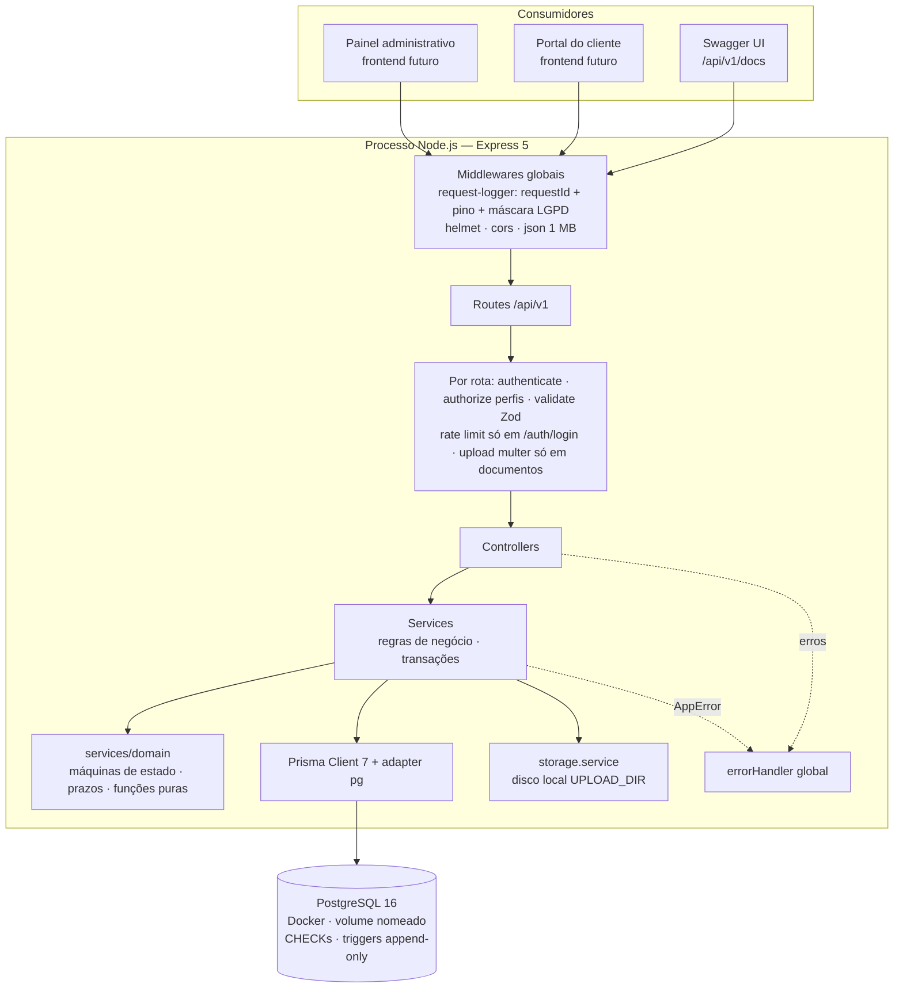
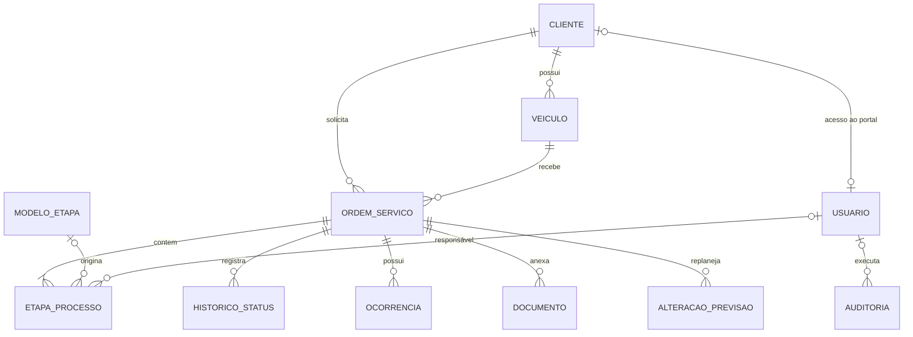

# Arquitetura — BlindTrack

> Versão final (Fase 6), revisada contra o código. Banco de dados em
> [docs/modelagem/modelo-de-dados.md](docs/modelagem/modelo-de-dados.md), fluxos em
> [docs/diagramas/diagramas-de-sequencia.md](docs/diagramas/diagramas-de-sequencia.md),
> qualidade em [docs/qualidade/](docs/qualidade/).

## 1. Visão geral

A API REST é um **monólito modular** em Node.js + Express 5 + TypeScript, com persistência
em PostgreSQL 16 via Prisma ORM 7. Ela atende dois "ambientes" lógicos, separados por rotas e
perfis:

- **Painel administrativo:** `/api/v1/*` para os perfis ADMIN, GESTOR, TECNICO e ATENDIMENTO.
- **Portal do cliente:** `/api/v1/cliente/*`, só para o perfil CLIENTE, somente leitura.

O projeto entrega a **API**. Os frontends do painel e do portal estão fora do escopo; o
Swagger UI serve como cliente interativo.



## 2. Padrões arquiteturais

| Padrão                       | Onde                                                                                   | Por quê                                                                                                                                                                                                 |
| ---------------------------- | -------------------------------------------------------------------------------------- | ------------------------------------------------------------------------------------------------------------------------------------------------------------------------------------------------------- |
| Arquitetura em camadas       | Routes → Middlewares → Controllers → Services → Prisma                                 | Exigência do projeto. Cada camada tem uma responsabilidade; as rotas nunca acessam o banco e os controllers não têm regra de negócio.                                                                   |
| Monólito modular             | Um módulo por recurso (`ordem-servico.*`, `etapa.*`...)                                | Simples de implantar e testar, com fronteiras claras (ver abaixo).                                                                                                                                      |
| Máquina de estados explícita | `src/services/domain/*.state-machine.ts`                                               | As transições de status (OS, etapa, ocorrência) são a regra central. Tabelas de transição puras são testáveis sem banco e não se espalham pelos services.                                               |
| Unit of Work (transação)     | `prisma.$transaction(async (tx) => …)`                                                 | Alteração + histórico + auditoria são atômicos (RN29).                                                                                                                                                  |
| Funções que aceitam o client | `registrarHistorico(db, …)`, `registrarAuditoria(db, …)`, `buscarOrdemOperavel(db, …)` | As operações reutilizadas recebem o client ou a transação por parâmetro e participam da transação de quem as chama. Os casos de uso usam o client global (sem container de DI, que seria excesso aqui). |
| Erros de domínio tipados     | `AppError` (`NotFound`, `Conflict`, `BusinessRule`, `Forbidden`…)                      | Os controllers não montam status HTTP de erro. O `errorHandler` traduz tudo num formato único (RNF16).                                                                                                  |
| Schemas como contrato        | Zod em `src/validators`                                                                | Uma fonte para validação em tempo de execução, tipos TypeScript (`z.infer`) e documentação OpenAPI (ADR-23).                                                                                            |

### Fronteiras entre módulos

O enunciado exige pastas **por camada** (`controllers/`, `services/`...). A modularidade
fica na **nomenclatura e nas regras de dependência**:

- cada módulo tem `<modulo>.routes.ts`, `<modulo>.controller.ts`, `<modulo>.service.ts` e `<modulo>.schema.ts`;
- **leituras** entre módulos são livres (ex.: o service de etapa lê ocorrências e documentos para aplicar RN12 e RN17);
- **escritas** em tabelas de outro módulo passam por funções exportadas (`sincronizarStatusOrdem`, `replanejarEntrega`, `registrarHistorico`, `registrarAuditoria`), com três exceções deliberadas, todas na mesma transação:
  1. abrir a OS cria as etapas como escrita aninhada (composição, RN04);
  2. inativar o cliente desativa o usuário do portal (RN36);
  3. `alteracoes_previsao` é gravada pelos services de OS e de etapa (replanejamento da entrega e da etapa).
- histórico, auditoria e storage são serviços transversais.

## 3. Justificativas tecnológicas

| Escolha                                     | Justificativa                                                                                                                                                                                                     |
| ------------------------------------------- | ----------------------------------------------------------------------------------------------------------------------------------------------------------------------------------------------------------------- |
| **Node.js 24 LTS** (compatível com ≥ 22.13) | Linha LTS ativa. Fixada em `.nvmrc`; `engines` aceita 22.13+. Testado também no Node 26.                                                                                                                          |
| **Express 5**                               | Estável e simples. A v5 encaminha ao `errorHandler` as rejeições de handlers `async`, o que elimina wrappers `asyncHandler`.                                                                                      |
| **TypeScript 5.9 strict** (ESM, `NodeNext`) | Tipagem explícita; `any` proibido no lint. A 5.9 foi escolhida porque o `typescript-eslint` ainda não suporta o TypeScript 7.                                                                                     |
| **PostgreSQL 16**                           | Integridade referencial, `timestamptz`, `uuid`, sequences, CHECKs, triggers (append-only) e `jsonb` (auditoria).                                                                                                  |
| **Prisma ORM 7.10.1**                       | Schema declarativo, migrations versionadas, client tipado. Última versão estável (a tag `latest` do npm apontava para um release candidate da 8). Usa driver adapter (`@prisma/adapter-pg`) e `prisma.config.ts`. |
| **Zod 4**                                   | Validação declarativa com inferência de tipos e geração de JSON Schema para o OpenAPI.                                                                                                                            |
| **jsonwebtoken + bcrypt**                   | Padrão de mercado. HS256 com algoritmo fixado; bcrypt com custo 12.                                                                                                                                               |
| **Helmet / cors**                           | Cabeçalhos de segurança e lista de origens configurável no `.env`.                                                                                                                                                |
| **Pino / pino-http**                        | Logs estruturados em JSON, com `redact` de campos sensíveis e máscara de parâmetros de busca (ADR-24).                                                                                                            |
| **Swagger UI + OpenAPI 3.0**                | Documentação navegável, gerada dos schemas e testada contra as rotas.                                                                                                                                             |
| **Vitest + Supertest**                      | O Vitest roda TypeScript/ESM sem configuração extra; o Supertest exercita o app sem abrir porta.                                                                                                                  |
| **tsx + nodemon**                           | Execução direta de TypeScript e recarga ao salvar.                                                                                                                                                                |
| **multer** _(extra)_                        | Upload `multipart/form-data`; o Express não o trata nativamente.                                                                                                                                                  |
| **express-rate-limit** _(extra)_            | Limite de tentativas de login falhas (RNF05).                                                                                                                                                                     |
| **@prisma/adapter-pg + pg** _(extra)_       | Exigidos pelo Prisma 7 para conectar ao PostgreSQL.                                                                                                                                                               |

## 4. Estrutura de pastas

```
Blindada-veiculo/
├── docs/
│   ├── README.md              # índice da documentação
│   ├── requisitos/            # visão geral, RF, RNF, regras de negócio
│   ├── casos-de-uso/          # diagrama e especificações
│   ├── modelagem/             # DER, decisões, restrições, índices
│   ├── diagramas/             # classes, sequência (Mermaid)
│   ├── api/                   # openapi.json (gerado)
│   ├── qualidade/             # plano de testes, revisão de segurança
│   └── evidencias/            # saídas reais de testes, cobertura, audit, instalação limpa
├── kanban-prints/             # capturas do quadro de tarefas (preenchidas pelo desenvolvedor)
├── prisma/
│   ├── schema.prisma
│   ├── migrations/            # geradas pelo Prisma + SQL manual documentado
│   └── seed.ts
├── src/
│   ├── config/                # env (Zod), logger, prisma, swagger (OpenAPI)
│   ├── controllers/           # <modulo>.controller.ts
│   ├── services/              # <modulo>.service.ts, historico, auditoria, storage
│   │   └── domain/            # máquinas de estado, prazos, constantes (funções puras)
│   ├── routes/                # <modulo>.routes.ts + index.ts (monta /api/v1)
│   ├── middlewares/           # authenticate, authorize, validate, upload, rate-limit,
│   │                          # request-logger, error-handler, not-found
│   ├── validators/            # <modulo>.schema.ts (Zod) + comum.schema.ts
│   ├── utils/                 # app-error, documento (CPF/CNPJ), veiculo-identificacao,
│   │                          # paginacao, json, download, contexto-requisicao
│   ├── types/                 # auth.ts, express.d.ts (req.user)
│   ├── generated/prisma/      # (fora do git) Prisma Client gerado
│   ├── app.ts                 # cria e configura o Express (sem listen, para os testes)
│   └── server.ts              # conecta ao banco, listen, encerramento gracioso
├── scripts/                   # gerar-openapi.ts
├── tests/
│   ├── unit/                  # domínio, validadores, segurança, error handler (sem banco)
│   ├── integration/           # Supertest + PostgreSQL real (banco blindtrack_test)
│   ├── helpers/               # fábrica de dados, limpeza do banco
│   └── setup/                 # globalSetup: migrations no banco de teste, limpeza de uploads
├── docker/postgres/init/      # cria o banco de testes na 1ª subida do container
├── uploads/, uploads-test/    # (fora do git) arquivos enviados
├── .env.example, .gitignore, .nvmrc, .prettierrc.json, eslint.config.js
├── arquitetura.md, README.md, DOCUMENTACAO_IA.md
├── docker-compose.yml
└── package.json, tsconfig.json, tsconfig.build.json, vitest.config.ts, nodemon.json, prisma.config.ts
```

## 5. Fluxo de uma requisição

Exemplo: o técnico conclui uma etapa. Outros fluxos estão em
[diagramas-de-sequencia.md](docs/diagramas/diagramas-de-sequencia.md).

```mermaid
sequenceDiagram
    autonumber
    actor T as Técnico
    participant L as request-logger
    participant R as etapa.routes
    participant MW as authenticate → authorize → validate
    participant C as etapa.controller
    participant S as etapa.service
    participant D as etapa.state-machine
    participant DB as Prisma ($transaction)
    participant EH as errorHandler

    T->>L: PATCH /api/v1/etapas/:id/status {acao:"CONCLUIR"}
    L->>R: requestId + log (CPF/e-mail mascarados)
    R->>MW: JWT válido? usuário ativo? perfil permitido? corpo válido?
    MW->>C: req.user + corpo validado
    C->>S: alterarStatusEtapa(id, dados, contexto)
    S->>DB: begin; etapa, OS, etapas da OS, ocorrências impeditivas
    S->>D: validarTransicaoEtapa(CONCLUIR, contexto)
    alt regra violada
        D-->>S: BusinessRuleError (ex.: RN12)
        S-->>EH: rollback
        EH-->>T: 422 {error: {code: "RN12", message, requestId}}
    else ok
        S->>DB: UPDATE etapa ... WHERE status = EM_ANDAMENTO (0 linhas → 409)
        S->>DB: INSERT historico_status; INSERT auditoria
        S->>DB: recalcula o status da OS (+ histórico)
        S->>DB: commit
        S-->>C: etapa + statusOrdem
        C-->>T: 200 {data}
    end
```

## 6. Decisões arquiteturais (ADRs)

| #      | Decisão                                                                                                                                                                                                                           | Alternativas                              | Motivo                                                                                                                                                                                            |
| ------ | --------------------------------------------------------------------------------------------------------------------------------------------------------------------------------------------------------------------------------- | ----------------------------------------- | ------------------------------------------------------------------------------------------------------------------------------------------------------------------------------------------------- |
| ADR-01 | Etapas geradas de uma tabela **`ModeloEtapa`**; a OS guarda uma cópia.                                                                                                                                                            | Enum fixo de etapas.                      | Etapas "configuráveis" sem migration, e mudar o modelo não reescreve o passado.                                                                                                                   |
| ADR-02 | Entidade **`AlteracaoPrevisao`**.                                                                                                                                                                                                 | Justificativa como texto no histórico.    | Prazo planejado × real e justificativa estruturada (RN26).                                                                                                                                        |
| ADR-03 | `HistoricoStatus` único, com `tipoEvento` e status em texto.                                                                                                                                                                      | Uma tabela por entidade.                  | Facilita a linha do tempo; os valores sempre vêm dos enums.                                                                                                                                       |
| ADR-04 | _Append-only_ **também no banco**: triggers rejeitam `UPDATE`/`DELETE` em `historico_status`, `auditoria` e `alteracoes_previsao`.                                                                                                | Só na aplicação.                          | Defesa em profundidade: nem bug nem acesso direto apagam a trilha.                                                                                                                                |
| ADR-05 | Atraso **calculado na consulta**.                                                                                                                                                                                                 | Job que marca `atrasada`.                 | Sem dado desatualizado nem infraestrutura extra.                                                                                                                                                  |
| ADR-06 | Usuário CLIENTE = `Usuario` com `clienteId`.                                                                                                                                                                                      | Login separado para clientes.             | Um só mecanismo de autenticação.                                                                                                                                                                  |
| ADR-07 | Recurso de outro cliente responde **404**.                                                                                                                                                                                        | 403.                                      | Não revelar a existência de OS de terceiros.                                                                                                                                                      |
| ADR-08 | Soft delete só em `Cliente`; `Usuario` usa `ativo`; nada mais é excluído.                                                                                                                                                         | Soft delete em tudo.                      | Só onde há exclusão de negócio.                                                                                                                                                                   |
| ADR-09 | Número da OS por `SEQUENCE`.                                                                                                                                                                                                      | `MAX(numero)+1`.                          | Atômico sob concorrência.                                                                                                                                                                         |
| ADR-10 | Concorrência por **atualização condicional** (`WHERE status = esperado`).                                                                                                                                                         | `SELECT … FOR UPDATE`.                    | Suficiente para transições de status, sem SQL bruto.                                                                                                                                              |
| ADR-11 | Só _access token_ JWT (8 h).                                                                                                                                                                                                      | Access + refresh token.                   | Escopo acadêmico; mitigado pela ADR-15 e pela ADR-25.                                                                                                                                             |
| ADR-12 | Arquivos em disco local atrás do `storage.service`.                                                                                                                                                                               | S3/MinIO.                                 | Simplicidade; trocável sem mexer nos demais services.                                                                                                                                             |
| ADR-13 | Testes contra **PostgreSQL real** (`blindtrack_test`).                                                                                                                                                                            | SQLite / memória.                         | Proibido pelo enunciado; só o banco real exercita triggers e índices parciais.                                                                                                                    |
| ADR-14 | Prefixo **`/api/v1`**.                                                                                                                                                                                                            | `/api`.                                   | Versionamento para evolução da API.                                                                                                                                                               |
| ADR-15 | `authenticate` **recarrega o usuário** a cada requisição.                                                                                                                                                                         | Confiar só no JWT.                        | Desativação e mudança de perfil valem na hora.                                                                                                                                                    |
| ADR-16 | Projeção por perfil: TECNICO recebe cliente com documento mascarado.                                                                                                                                                              | Mesmo payload para todos.                 | Minimização de dados (LGPD).                                                                                                                                                                      |
| ADR-17 | Middleware `validate` substitui `body`/`params`/`query` pelos valores normalizados; schemas `strict`.                                                                                                                             | Validar no controller.                    | Ponto único de validação; proteção contra mass assignment.                                                                                                                                        |
| ADR-18 | CNPJ alfanumérico aceito.                                                                                                                                                                                                         | Só numérico.                              | Exigência legal vigente desde julho/2026.                                                                                                                                                         |
| ADR-19 | Linha do tempo do portal com **mensagens padronizadas**.                                                                                                                                                                          | Exibir a descrição interna.               | A descrição interna pode conter justificativas e nomes.                                                                                                                                           |
| ADR-20 | Regras de estado e prazo como **funções puras** em `services/domain`.                                                                                                                                                             | Regras espalhadas nos services.           | Testáveis sem banco (`tests/unit/dominio.test.ts`) e reutilizadas.                                                                                                                                |
| ADR-21 | Upload validado pela **assinatura binária**, nome UUID, hash SHA-256.                                                                                                                                                             | Confiar na extensão/MIME.                 | Impede arquivo disfarçado e path traversal.                                                                                                                                                       |
| ADR-22 | Transações com `maxWait` 10 s / `timeout` 20 s.                                                                                                                                                                                   | Padrão (2 s / 5 s).                       | Abrir uma OS grava várias tabelas; em máquinas lentas 5 s não bastava.                                                                                                                            |
| ADR-23 | OpenAPI **gerado dos schemas Zod**.                                                                                                                                                                                               | YAML manual; JSDoc.                       | Validação e documentação não divergem; teste de contrato confere rotas e perfis.                                                                                                                  |
| ADR-24 | **Máscara de parâmetros de busca** (CPF, e-mail, nome, placa...) nos logs HTTP.                                                                                                                                                   | Só `redact`.                              | A busca por CPF gravava o CPF no log (achado S1).                                                                                                                                                 |
| ADR-25 | **Revogação de sessão na troca de senha** (`senha_alterada_em` × `iat`).                                                                                                                                                          | Lista de tokens revogados.                | Aproveita a consulta da ADR-15, sem store extra (achado S2).                                                                                                                                      |
| ADR-26 | **Sessão do front-end por cookie HttpOnly** (`bt_sessao`, SameSite=Strict, Secure em produção, `Path=/api`). Escritas autenticadas por cookie exigem `X-Requested-With: BlindTrack`. Bearer continua aceito para clientes de API. | Token em `localStorage`/`sessionStorage`. | O JavaScript da página nunca acessa o token (um XSS não o rouba). O cabeçalho próprio, mais o CORS restrito, bloqueia CSRF. Quando a requisição vem do app, o login nem devolve o token no corpo. |

## 7. Matriz de permissões

Verificada automaticamente para as 45 operações e os 5 perfis em
[`tests/integration/openapi.test.ts`](tests/integration/openapi.test.ts).

| Recurso / ação                                          | ADMIN | GESTOR |       TECNICO       |     ATENDIMENTO     |       CLIENTE       |
| ------------------------------------------------------- | :---: | :----: | :-----------------: | :-----------------: | :-----------------: |
| Usuários: criar, consultar, editar, desativar           |  ✅   |   —    |          —          |          —          |          —          |
| Usuários: lista mínima de responsáveis                  |  ✅   |   ✅   |          —          |          —          |          —          |
| Dashboard: indicadores                                  |  ✅   |   ✅   |         ✅          |         ✅          |          —          |
| Clientes: criar / editar                                |  ✅   |   ✅   |          —          |         ✅          |          —          |
| Clientes: corrigir CPF/CNPJ, inativar                   |  ✅   |   ✅   |          —          |          —          |          —          |
| Clientes / veículos: consultar                          |  ✅   |   ✅   |          👁          |         ✅          |          —          |
| Veículos: criar / editar                                |  ✅   |   ✅   |          —          |         ✅          |          —          |
| OS: abrir / editar observações                          |  ✅   |   ✅   |          —          |         ✅          |          —          |
| OS: suspender, retomar, cancelar, replanejar            |  ✅   |   ✅   |          —          |          —          |          —          |
| OS, etapas, histórico, linha do tempo: consultar        |  ✅   |   ✅   |         ✅          |         ✅          |          —          |
| Etapa: alterar status                                   |  ✅   |   ✅   | ✅ (só as próprias) |          —          |          —          |
| Etapa: dispensar / reabrir                              |  ✅   |   ✅   |          —          |          —          |          —          |
| Etapa: responsável / prazo                              |  ✅   |   ✅   |          —          |          —          |          —          |
| Modelo de etapas                                        |  ✅   |   ✅   |          —          |          —          |          —          |
| Ocorrência: abrir                                       |  ✅   |   ✅   |         ✅          |         ✅          |          —          |
| Ocorrência: alterar, resolver, cancelar                 |  ✅   |   ✅   | ✅ (se responsável) | ✅ (se responsável) |          —          |
| Documento: enviar, listar, baixar                       |  ✅   |   ✅   |         ✅          |         ✅          |          —          |
| Documento: aprovar / rejeitar                           |  ✅   |   ✅   |          —          |          —          |          —          |
| Portal: minhas OS, acompanhar, baixar documento visível |   —   |   —    |          —          |          —          | ✅ (só as próprias) |

👁 = somente leitura, com dados reduzidos (ADR-16).

## 8. Mapa da API (`/api/v1`)

| Método           | Rota                                   | Observação                                                                                                                                            |
| ---------------- | -------------------------------------- | ----------------------------------------------------------------------------------------------------------------------------------------------------- |
| GET              | `/health`                              | Público; checa API e banco                                                                                                                            |
| GET              | `/docs`                                | Swagger UI                                                                                                                                            |
| POST             | `/auth/login`                          | Público; limite de tentativas falhas por IP                                                                                                           |
| GET              | `/auth/me`                             |                                                                                                                                                       |
| PATCH            | `/auth/senha`                          | _(extra, RF05)_ troca da própria senha; revoga sessões anteriores e apaga o cookie                                                                    |
| POST             | `/auth/logout`                         | _(extra, P8)_ apaga o cookie de sessão; idempotente                                                                                                   |
| POST/GET         | `/usuarios`                            | `?perfil&ativo&busca&page&pageSize`                                                                                                                   |
| GET              | `/usuarios/responsaveis`               | _(extra, P7)_ TECNICO/GESTOR ativos (id, nome, perfil); ADMIN e GESTOR                                                                                |
| GET/PATCH        | `/usuarios/:id`                        | Desativar = `PATCH {ativo:false}`                                                                                                                     |
| POST/GET         | `/clientes`                            | `?nome&documento&email&tipoPessoa&incluirInativos&page&pageSize`                                                                                      |
| GET/PATCH/DELETE | `/clientes/:id`                        | `DELETE` = inativação lógica                                                                                                                          |
| POST/GET         | `/veiculos`                            | `?placa&chassi&clienteId&busca`                                                                                                                       |
| GET/PATCH        | `/veiculos/:id`                        |                                                                                                                                                       |
| POST/GET         | `/ordens-servico`                      | `?status&clienteId&veiculoId&placa&numero&cliente&atrasada&entradaDe&entradaAte&ordenarPor&direcao`; cada item traz `etapaAtual` com responsável (P2) |
| GET/PATCH        | `/ordens-servico/:id`                  | PATCH: observações                                                                                                                                    |
| PATCH            | `/ordens-servico/:id/status`           | `{acao: SUSPENDER\|RETOMAR\|CANCELAR, justificativa}`                                                                                                 |
| PATCH            | `/ordens-servico/:id/previsao`         | _(extra)_ replanejamento com justificativa                                                                                                            |
| GET              | `/ordens-servico/:id/etapas`           | Com indicador de prazo                                                                                                                                |
| PATCH            | `/etapas/:id/status`                   | `{acao: INICIAR\|PAUSAR\|RETOMAR\|CONCLUIR\|DISPENSAR\|REABRIR, justificativa?}`                                                                      |
| PATCH            | `/etapas/:id/responsavel`              |                                                                                                                                                       |
| PATCH            | `/etapas/:id/prazo`                    |                                                                                                                                                       |
| GET              | `/ordens-servico/:id/historico`        |                                                                                                                                                       |
| GET              | `/ordens-servico/:id/linha-do-tempo`   | Histórico + replanejamentos                                                                                                                           |
| POST/GET         | `/ordens-servico/:id/ocorrencias`      | GET: `?status&tipo&prioridade`                                                                                                                        |
| PATCH            | `/ocorrencias/:id`                     | Inclui as transições de status                                                                                                                        |
| POST/GET         | `/ordens-servico/:id/documentos`       | POST: `multipart/form-data`                                                                                                                           |
| GET              | `/documentos/:id/arquivo`              | _(extra)_ download                                                                                                                                    |
| PATCH            | `/documentos/:id/status`               | _(extra)_ aprovar/rejeitar                                                                                                                            |
| GET/POST, PATCH  | `/modelos-etapa`, `/modelos-etapa/:id` | _(extra)_ configuração das etapas (RF23)                                                                                                              |
| GET              | `/dashboard/indicadores`               | _(extra, P1/RF43)_ indicadores agregados da operação                                                                                                  |
| GET              | `/cliente/minhas-ordens`               | Portal                                                                                                                                                |
| GET              | `/cliente/ordens/:id/acompanhar`       | Portal                                                                                                                                                |
| GET              | `/cliente/documentos/:id/arquivo`      | _(extra)_ portal: documento visível da própria OS                                                                                                     |

Os endpoints _(extra)_ não constam no enunciado, mas são necessários para cumprir RF05,
RF23, RN13, RN17 e RN26.

## 9. Entidades

Entidades do enunciado: `Cliente`, `Veiculo`, `Usuario`, `OrdemServico`, `EtapaProcesso`,
`HistoricoStatus`, `Ocorrencia`, `Documento`, `Auditoria`. Adicionadas: `ModeloEtapa`
(ADR-01) e `AlteracaoPrevisao` (ADR-02).



Campos, índices, CHECKs e triggers: [modelo-de-dados.md](docs/modelagem/modelo-de-dados.md).
Classes de domínio: [diagrama-de-classes.md](docs/diagramas/diagrama-de-classes.md).

## 10. Requisitos não implementados

| Requisito                                               | Prioridade     | Situação                                                                                                             |
| ------------------------------------------------------- | -------------- | -------------------------------------------------------------------------------------------------------------------- |
| RF28 — Consultar a trilha de auditoria por entidade     | Desejável      | A auditoria é **gravada** em todas as escritas, mas não há endpoint de consulta. Hoje, só via banco (Prisma Studio). |
| ~~RF43 — Painel resumido~~                              | Desejável      | **Implementado na Fase 4c** (`GET /dashboard/indicadores`).                                                          |
| Frontend (painel e portal)                              | Fora do escopo | O projeto entrega a API. O Swagger UI serve como cliente.                                                            |
| RNF14 — Meta de desempenho (p95 < 500 ms com 10 mil OS) | Obrigatório    | Índices criados para os filtros, mas **sem teste de carga** que comprove a meta.                                     |

Todos os requisitos obrigatórios (M) de funcionalidade estão implementados e cobertos por
testes. Veja a rastreabilidade em [plano-de-testes.md](docs/qualidade/plano-de-testes.md).
