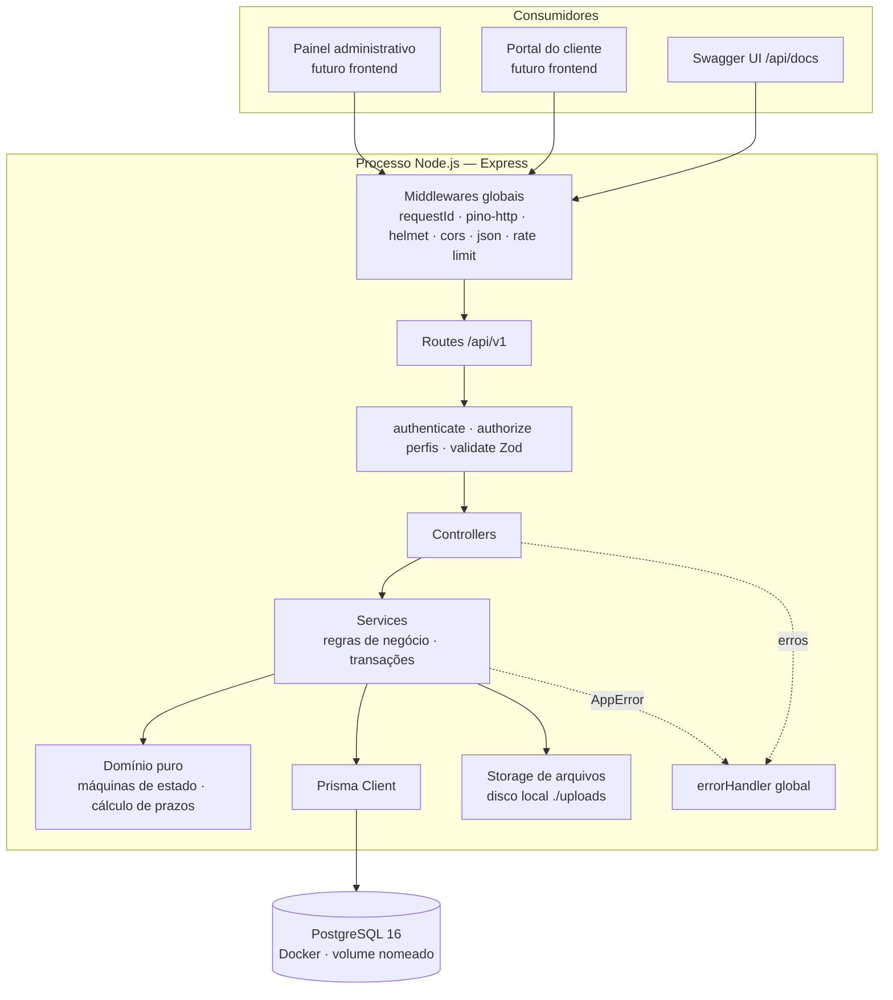
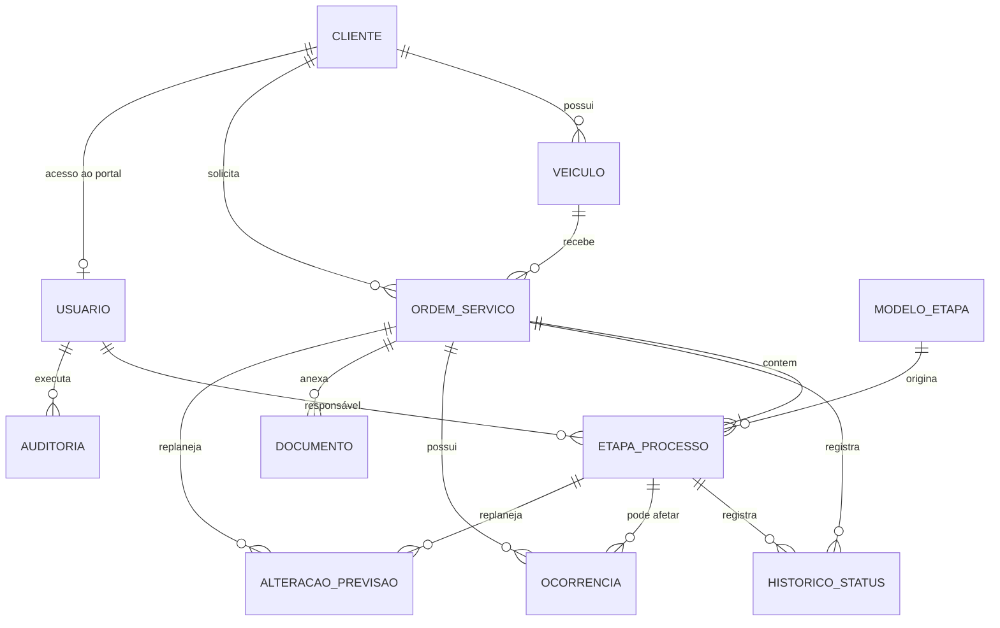

# Arquitetura — BlindTrack

> Status: **Fase 5 concluída** (API completa, documentada e revisada). Banco em [docs/modelagem/modelo-de-dados.md](docs/modelagem/modelo-de-dados.md); qualidade em [docs/qualidade/](docs/qualidade/). Este documento será revisado na Fase 6.

## 1. Visão geral

A API REST é um monólito modular em Node.js + Express + TypeScript, com persistência em
PostgreSQL 16 via Prisma ORM. Ela atende dois "ambientes" lógicos, separados por rotas e
perfis:

- **Painel administrativo**: `/api/v1/*` para os perfis ADMIN, GESTOR, TECNICO e ATENDIMENTO.
- **Portal do cliente**: `/api/v1/cliente/*`, só para o perfil CLIENTE, somente leitura.



## 2. Padrões arquiteturais

| Padrão                       | Onde                                                                 | Por quê                                                                                                                                                             |
| ---------------------------- | -------------------------------------------------------------------- | ------------------------------------------------------------------------------------------------------------------------------------------------------------------- |
| Arquitetura em camadas       | Routes → Middlewares → Controllers → Services → Prisma               | Exigência do projeto. Cada camada tem uma única responsabilidade e só depende da camada abaixo.                                                                     |
| Monólito modular             | Um módulo de domínio por recurso (`ordem-servico.*`, `etapa.*` etc.) | Simples de implantar e testar num projeto acadêmico, com fronteiras claras para extrair serviços no futuro, se fizer sentido.                                       |
| Máquina de estados explícita | `src/services/domain/*.state-machine.ts`                             | As transições de status (OS, etapa, ocorrência) são a regra de negócio central. Uma tabela de transições pura é testável sem banco e não se espalha pelos services. |
| Unit of Work (transação)     | `prisma.$transaction(async (tx) => …)` nos services                  | Garante que alteração + histórico + auditoria sejam atômicos (RN29).                                                                                                |
| Injeção de dependência leve  | Services recebem o client/`tx` do Prisma como parâmetro              | Permite reutilizar o mesmo service dentro de outra transação e facilita os testes. Sem container de DI, que seria excesso para o tamanho do projeto.                |
| Erros de domínio tipados     | `AppError` (`NotFound`, `Conflict`, `BusinessRule`, `Forbidden`…)    | Os controllers não montam status HTTP à mão. O `errorHandler` traduz os erros num formato único (RNF16).                                                            |
| DTOs validados               | Schemas Zod em `src/validators`                                      | Uma única fonte para validação em tempo de execução e para os tipos TypeScript (`z.infer`). Também alimenta o OpenAPI.                                              |

### Sobre "monólito modular" × estrutura de pastas exigida

O enunciado exige pastas **por camada** (`controllers/`, `services/`, `routes/`…). Para manter a
modularidade sem fugir dessa estrutura, a modularidade fica na **nomenclatura e nas regras de
dependência**:

- cada módulo tem `<modulo>.routes.ts`, `<modulo>.controller.ts`, `<modulo>.service.ts` e `<modulo>.schema.ts`;
- um service **só chama outro service pela interface exportada**, nunca acessando as tabelas do outro módulo para escrever;
- histórico e auditoria são serviços transversais (`historico.service.ts`, `auditoria.service.ts`) usados pelos demais.

## 3. Justificativas tecnológicas

| Escolha                                       | Justificativa                                                                                                                                                                                                                                        |
| --------------------------------------------- | ---------------------------------------------------------------------------------------------------------------------------------------------------------------------------------------------------------------------------------------------------- |
| **Node.js 24 LTS** (compatível com 22 LTS)    | Linha LTS ativa, com suporte longo. Fixada em `.nvmrc` e `engines`.                                                                                                                                                                                  |
| **Express 5**                                 | Estável e mais simples que alternativas opinativas. A v5 encaminha ao `errorHandler` as rejeições de handlers `async`, o que elimina wrappers `asyncHandler`.                                                                                        |
| **TypeScript strict**                         | Tipagem explícita (requisito de qualidade). Os tipos do Prisma e do Zod fluem até os controllers.                                                                                                                                                    |
| **PostgreSQL 16**                             | Integridade referencial forte, `timestamptz`, `uuid`, sequências, triggers (para o _append-only_) e `jsonb` (para a auditoria).                                                                                                                      |
| **Prisma ORM (linha 7.x)**                    | Schema declarativo, migrations versionadas e um client tipado. A versão exata será fixada na Fase 2, depois de checar a compatibilidade com Node 22/24 e PG16. Na linha 7 o Prisma usa _driver adapter_ (`@prisma/adapter-pg`) e `prisma.config.ts`. |
| **Zod**                                       | Validação declarativa com inferência de tipos. Reaproveitado no OpenAPI.                                                                                                                                                                             |
| **jsonwebtoken + bcrypt**                     | Padrão de mercado. O bcrypt é lento por design, o que dificulta força bruta.                                                                                                                                                                         |
| **Helmet / cors**                             | Cabeçalhos de segurança e controle de origens configurável via `.env`.                                                                                                                                                                               |
| **Pino / pino-http**                          | Logs estruturados em JSON, rápidos, com `redact` para dados sensíveis (LGPD).                                                                                                                                                                        |
| **Swagger UI + OpenAPI 3**                    | Documentação navegável e testável.                                                                                                                                                                                                                   |
| **Vitest + Supertest**                        | O Vitest roda TypeScript sem configurar ts-jest e é rápido. O Supertest exercita o app Express sem abrir porta.                                                                                                                                      |
| **tsx + nodemon**                             | O `tsx` executa TypeScript direto e o `nodemon` reinicia o servidor ao salvar.                                                                                                                                                                       |
| **multer** _(extra, justificado)_             | Necessário para o upload `multipart/form-data` de documentos. O Express não trata isso nativamente.                                                                                                                                                  |
| **express-rate-limit** _(extra, justificado)_ | Limita tentativas de login (RNF05), mitigando força bruta.                                                                                                                                                                                           |

Fora da stack obrigatória, apenas `multer`, `express-rate-limit` e `@prisma/adapter-pg`
(exigido pelo Prisma 7) são adicionados, todos justificados acima.

## 4. Estrutura de pastas

```
meu-projeto/
├── docs/
│   ├── requisitos/            # visão, RF, RNF, regras de negócio
│   ├── diagramas/             # arquitetura, sequência, classes (Mermaid)
│   ├── casos-de-uso/          # diagrama e especificação dos casos de uso
│   ├── modelagem/             # DER, dicionário de dados
│   └── api/                   # openapi.yaml, exemplos de requisição
├── kanban-prints/             # evidências do quadro de tarefas
├── prisma/
│   ├── schema.prisma
│   ├── migrations/            # geradas pelo `prisma migrate dev` (nunca à mão, salvo SQL extra)
│   └── seed.ts
├── src/
│   ├── config/                # env.ts (validação do .env com Zod), logger.ts, prisma.ts, swagger.ts
│   ├── controllers/           # <modulo>.controller.ts
│   ├── services/              # <modulo>.service.ts
│   │   └── domain/            # máquinas de estado e cálculo de prazos (funções puras)
│   ├── routes/                # <modulo>.routes.ts + index.ts (monta /api/v1)
│   ├── middlewares/           # authenticate, authorize, validate, upload, error-handler, not-found
│   ├── validators/            # <modulo>.schema.ts (Zod)
│   ├── utils/                 # app-error.ts, paginacao.ts, cpf-cnpj.ts, placa-chassi.ts
│   ├── types/                 # express.d.ts (req.user), tipos compartilhados
│   ├── generated/prisma/      # (gitignored) Prisma Client gerado
│   ├── app.ts                 # cria e configura o Express (sem listen, para os testes)
│   └── server.ts              # carrega env, conecta ao banco, listen, shutdown gracioso
├── scripts/                   # gerar-openapi.ts (exporta docs/api/openapi.json)
├── tests/
│   ├── unit/                  # máquinas de estado, prazos, validadores, services com tx mockado
│   └── integration/           # Supertest + PostgreSQL real (banco blindtrack_test)
├── docker/postgres/init/      # script que cria o banco de testes na 1ª subida do container
├── uploads/                   # (gitignored) arquivos enviados
├── .env / .env.example / .gitignore / .nvmrc
├── arquitetura.md / README.md / DOCUMENTACAO_IA.md
├── docker-compose.yml
├── package.json / tsconfig.json / vitest.config.ts / prisma.config.ts
```

## 5. Fluxo de uma requisição

Exemplo: técnico conclui uma etapa.

```mermaid
sequenceDiagram
    autonumber
    actor T as Técnico
    participant R as etapa.routes
    participant MW as authenticate / authorize / validate
    participant C as etapa.controller
    participant S as etapa.service
    participant D as etapa.state-machine
    participant DB as Prisma ($transaction)

    T->>R: PATCH /api/v1/etapas/:id/status {acao:"CONCLUIR"}
    R->>MW: verifica JWT, perfil, schema Zod
    MW->>C: req.user + body validado
    C->>S: alterarStatus(id, dto, usuario)
    S->>DB: begin; busca etapa + OS + etapas anteriores + ocorrências impeditivas
    S->>D: validarTransicao(EM_ANDAMENTO → CONCLUIDA, contexto)
    D-->>S: ok / BusinessRuleError
    S->>DB: UPDATE etapa SET status=CONCLUIDA, dataConclusao=now() WHERE id=? AND status=EM_ANDAMENTO
    S->>DB: INSERT historico_status; INSERT auditoria
    S->>DB: recalcula status da OS (ex.: PRONTA_PARA_ENTREGA) + histórico
    S->>DB: commit
    S-->>C: etapa atualizada
    C-->>T: 200 OK {data: etapa}
```

## 6. Decisões arquiteturais (ADR resumidas)

| #      | Decisão                                                                                                                                                          | Alternativas consideradas                         | Motivo                                                                                                                                                                                                      |
| ------ | ---------------------------------------------------------------------------------------------------------------------------------------------------------------- | ------------------------------------------------- | ----------------------------------------------------------------------------------------------------------------------------------------------------------------------------------------------------------- |
| ADR-01 | Etapas geradas a partir de uma tabela **`ModeloEtapa`** (seed com as 8 etapas).                                                                                  | Enum fixo de etapas.                              | O enunciado pede etapas "configuráveis". Com o modelo, é possível adicionar/reordenar etapas sem migration. A OS guarda uma cópia (nome, ordem, obrigatória), então mudar o modelo não reescreve o passado. |
| ADR-02 | Nova entidade **`AlteracaoPrevisao`**.                                                                                                                           | Guardar justificativas no histórico como texto.   | RN26 pede prazo planejado × real e justificativa estruturada. Uma tabela própria permite relatórios de desvio.                                                                                              |
| ADR-03 | `HistoricoStatus` com `tipoEvento` (enum) e `statusAnterior`/`statusNovo` em texto.                                                                              | Uma tabela de histórico por entidade.             | Uma tabela única facilita a linha do tempo. A consistência dos valores é garantida pelos services, que só gravam valores vindos dos enums.                                                                  |
| ADR-04 | _Append-only_ garantido **também no banco** (trigger que rejeita `UPDATE`/`DELETE` em `historico_status` e `auditoria`, criado numa migration SQL complementar). | Só na aplicação.                                  | Defesa em profundidade: nem um bug nem um acesso direto ao banco apagam a trilha.                                                                                                                           |
| ADR-05 | Atraso **calculado na consulta**, sem job agendado.                                                                                                              | Cron que marca `atrasada = true`.                 | Evita dado desatualizado e infraestrutura extra. O filtro `?atrasada=true` vira uma condição SQL indexável.                                                                                                 |
| ADR-06 | Usuário CLIENTE = `Usuario` com `perfil = CLIENTE` e `clienteId` preenchido.                                                                                     | Tabela de login separada para clientes.           | Um único mecanismo de autenticação. A autorização por propriedade se resume a comparar `req.user.clienteId`.                                                                                                |
| ADR-07 | Acesso negado a recurso de outro cliente retorna **404**.                                                                                                        | 403.                                              | Não revelar a existência de OS de terceiros (LGPD / enumeração).                                                                                                                                            |
| ADR-08 | Soft delete **só** em `Cliente` (`deletedAt`). `Usuario` usa `ativo`. Nada é excluído em OS, etapa, histórico, ocorrência, documento ou auditoria.               | Soft delete em tudo.                              | Soft delete onde não há exclusão de negócio só aumenta a complexidade das consultas.                                                                                                                        |
| ADR-09 | Número da OS a partir de uma `SEQUENCE` do PostgreSQL.                                                                                                           | `MAX(numero)+1`.                                  | `MAX+1` gera duplicidade com requisições concorrentes. A sequence é atômica.                                                                                                                                |
| ADR-10 | Controle de concorrência por **atualização condicional** (`updateMany where status = esperado`, conferindo `count`).                                             | `SELECT … FOR UPDATE` / nível Serializable.       | É suficiente para as transições de status e não exige SQL bruto nem retentativas.                                                                                                                           |
| ADR-11 | Apenas _access token_ JWT (expiração padrão de 8 h, configurável).                                                                                               | Access + refresh token.                           | Escopo acadêmico. O refresh token com rotação fica documentado como evolução.                                                                                                                               |
| ADR-12 | Arquivos em disco local por trás de uma interface `StorageService`.                                                                                              | S3/MinIO já na primeira versão.                   | Simplicidade. A interface permite trocar o armazenamento sem mexer nos services.                                                                                                                            |
| ADR-13 | Testes de integração contra um **PostgreSQL real** (banco `blindtrack_test` no mesmo container), limpo entre suítes.                                             | SQLite / banco em memória.                        | Proibido pelo enunciado. Além disso, só o PostgreSQL real exercita triggers, sequences e `timestamptz`.                                                                                                     |
| ADR-14 | Prefixo **`/api/v1`**. Os caminhos do enunciado são mantidos depois do prefixo (ex.: `/api/v1/ordens-servico`).                                                  | `/api` sem versão.                                | O enunciado pede versionamento "quando adequado". Uma API pública com portal de cliente tende a evoluir.                                                                                                    |
| ADR-15 | `authenticate` **recarrega o usuário do banco** a cada requisição.                                                                                               | Confiar só no conteúdo do JWT.                    | Desativação e mudança de perfil valem na hora, sem esperar o token de 8 h expirar (ADR-11 não tem revogação). O custo é uma consulta por chave primária.                                                    |
| ADR-16 | Projeção por perfil nos services: o TECNICO recebe cliente com documento mascarado e sem contato/endereço.                                                       | Mesmo payload para todos.                         | Minimização (LGPD): o técnico não precisa desses dados para executar a blindagem.                                                                                                                           |
| ADR-17 | Validação no middleware `validate`, que substitui `req.body/params/query` pelos valores normalizados. Os schemas são `strict`.                                   | Validar dentro de cada controller.                | Um ponto único de validação. Campos extras são rejeitados (proteção contra mass assignment).                                                                                                                |
| ADR-18 | CNPJ alfanumérico aceito (validador + CHECK ajustado na migration `cnpj_alfanumerico`).                                                                          | Só CNPJ numérico.                                 | Exigência legal vigente desde julho/2026. Sem isso, empresas novas não poderiam ser cadastradas.                                                                                                            |
| ADR-19 | Linha do tempo do portal com **mensagens padronizadas**, geradas a partir de tipo e status do evento.                                                            | Exibir a `descricao` do histórico.                | A descrição interna pode conter justificativas e nomes. O cliente vê só textos pensados para ele (`descricaoCliente` nas ocorrências).                                                                      |
| ADR-20 | Máquinas de estado e prazos como **funções puras** em `services/domain`.                                                                                         | Regras espalhadas nos services.                   | Testáveis sem banco (61 testes unitários) e reaproveitadas por vários services.                                                                                                                             |
| ADR-21 | Upload em memória, com o tipo validado pela **assinatura binária** antes de gravar em disco, nome gerado (UUID) e hash SHA-256.                                  | Confiar na extensão ou no MIME declarado.         | Impede arquivo disfarçado (ex.: HTML com extensão .pdf) e path traversal. O hash permite verificar a integridade.                                                                                           |
| ADR-22 | Transações interativas do Prisma com `maxWait` 10 s / `timeout` 20 s.                                                                                            | Padrão do Prisma (2 s / 5 s).                     | Abrir uma OS grava OS + 8 etapas + histórico + auditoria. Em máquinas lentas, 5 s não bastava. Os limites continuam finitos.                                                                                |
| ADR-23 | OpenAPI **gerado dos schemas Zod** (`z.toJSONSchema`), com metadados por operação em `config/swagger.ts`.                                                        | Escrever o YAML à mão; anotações JSDoc.           | Validação e documentação têm a mesma fonte e não divergem. Um teste de contrato confere que cada operação existe e respeita os perfis documentados.                                                         |
| ADR-24 | **Máscara de parâmetros sensíveis** na URL e na query dos logs HTTP.                                                                                             | Confiar só no `redact` (que não reescreve a URL). | A busca por CPF gravava o CPF no log (achado S1 da revisão de segurança).                                                                                                                                   |
| ADR-25 | **Revogação de sessão na troca de senha** (`senha_alterada_em` × `iat` do JWT).                                                                                  | Lista de tokens revogados; refresh token.         | Aproveita a consulta que o `authenticate` já faz por requisição (ADR-15): não precisa de store extra (achado S2).                                                                                           |

## 7. Matriz de permissões (resumo)

| Recurso / ação                     | ADMIN | GESTOR |       TECNICO       |     ATENDIMENTO     |       CLIENTE       |
| ---------------------------------- | :---: | :----: | :-----------------: | :-----------------: | :-----------------: |
| Usuários (CRUD)                    |  ✅   |   —    |          —          |          —          |          —          |
| Clientes: criar / editar           |  ✅   |   ✅   |          —          |         ✅          |          —          |
| Clientes: inativar                 |  ✅   |   ✅   |          —          |          —          |          —          |
| Veículos: criar / editar           |  ✅   |   ✅   |          —          |         ✅          |          —          |
| Veículos / clientes: consultar     |  ✅   |   ✅   |          👁          |         ✅          |          —          |
| OS: abrir / editar observações     |  ✅   |   ✅   |          —          |         ✅          |          —          |
| OS: suspender / cancelar           |  ✅   |   ✅   |          —          |          —          |          —          |
| OS: consultar                      |  ✅   |   ✅   |         ✅          |         ✅          |          —          |
| Etapa: alterar status              |  ✅   |   ✅   | ✅ (só as próprias) |          —          |          —          |
| Etapa: responsável / prazo         |  ✅   |   ✅   |          —          |          —          |          —          |
| Modelo de etapas                   |  ✅   |   ✅   |          —          |          —          |          —          |
| Ocorrência: abrir                  |  ✅   |   ✅   |         ✅          |         ✅          |          —          |
| Ocorrência: resolver / cancelar    |  ✅   |   ✅   | ✅ (se responsável) | ✅ (se responsável) |          —          |
| Documento: enviar                  |  ✅   |   ✅   |         ✅          |         ✅          |          —          |
| Documento: aprovar / rejeitar      |  ✅   |   ✅   |          —          |          —          |          —          |
| Histórico / linha do tempo         |  ✅   |   ✅   |         ✅          |         ✅          |          —          |
| Auditoria                          |  ✅   |   —    |          —          |          —          |          —          |
| Portal: minhas ordens / acompanhar |   —   |   —    |          —          |          —          | ✅ (só as próprias) |

👁 = somente leitura.

## 8. Mapa da API (`/api/v1`)

| Método           | Rota                                 | Observação                                                                       |
| ---------------- | ------------------------------------ | -------------------------------------------------------------------------------- |
| POST             | `/auth/login`                        | Público, com limite de tentativas falhas por IP                                  |
| PATCH            | `/auth/senha`                        | _(extra, RF05)_ troca da própria senha                                           |
| GET              | `/auth/me`                           |                                                                                  |
| POST/GET         | `/usuarios`                          |                                                                                  |
| GET/PATCH        | `/usuarios/:id`                      | Desativar = `PATCH {ativo:false}`                                                |
| POST/GET         | `/clientes`                          | `?nome&documento&page&pageSize`                                                  |
| GET/PATCH/DELETE | `/clientes/:id`                      | `DELETE` = inativação lógica                                                     |
| POST/GET         | `/veiculos`                          | `?placa&chassi&clienteId`                                                        |
| GET/PATCH        | `/veiculos/:id`                      |                                                                                  |
| POST/GET         | `/ordens-servico`                    | `?status&clienteId&placa&atrasada&dataInicio&dataFim`                            |
| GET/PATCH        | `/ordens-servico/:id`                |                                                                                  |
| PATCH            | `/ordens-servico/:id/status`         | `{acao: SUSPENDER\|RETOMAR\|CANCELAR, justificativa}`                            |
| PATCH            | `/ordens-servico/:id/previsao`       | _(extra)_ replanejamento da entrega com justificativa                            |
| GET              | `/ordens-servico/:id/etapas`         |                                                                                  |
| PATCH            | `/etapas/:id/status`                 | `{acao: INICIAR\|PAUSAR\|RETOMAR\|CONCLUIR\|DISPENSAR\|REABRIR, justificativa?}` |
| PATCH            | `/etapas/:id/responsavel`            |                                                                                  |
| PATCH            | `/etapas/:id/prazo`                  |                                                                                  |
| GET              | `/ordens-servico/:id/historico`      |                                                                                  |
| GET              | `/ordens-servico/:id/linha-do-tempo` |                                                                                  |
| POST/GET         | `/ordens-servico/:id/ocorrencias`    |                                                                                  |
| PATCH            | `/ocorrencias/:id`                   | inclui as transições de status                                                   |
| POST/GET         | `/ordens-servico/:id/documentos`     | `multipart/form-data`                                                            |
| GET              | `/documentos/:id/arquivo`            | _(extra)_ download                                                               |
| PATCH            | `/documentos/:id/status`             | _(extra)_ aprovar/rejeitar                                                       |
| GET/POST/PATCH   | `/modelos-etapa`                     | _(extra)_ configuração das etapas                                                |
| GET              | `/cliente/minhas-ordens`             | Portal                                                                           |
| GET              | `/cliente/ordens/:id/acompanhar`     | Portal                                                                           |
| GET              | `/cliente/documentos/:id/arquivo`    | _(extra)_ portal: download de documento visível da própria OS                    |
| GET              | `/docs`                              | Swagger UI                                                                       |
| GET              | `/health`                            | Checa API + banco                                                                |

Endpoints marcados _(extra)_ não constam no enunciado, mas são necessários para cumprir as regras RN13, RN17, RN26 e RF23.

## 9. Entidades (antecipação da Fase 3)

Entidades do enunciado: `Cliente`, `Veiculo`, `Usuario`, `OrdemServico`, `EtapaProcesso`,
`HistoricoStatus`, `Ocorrencia`, `Documento`, `Auditoria`.
Adicionadas: `ModeloEtapa` (ADR-01) e `AlteracaoPrevisao` (ADR-02).



O detalhamento de campos, índices, CHECKs e triggers está em [docs/modelagem/modelo-de-dados.md](docs/modelagem/modelo-de-dados.md). O diagrama de classes está em [docs/diagramas/diagrama-de-classes.md](docs/diagramas/diagrama-de-classes.md).
