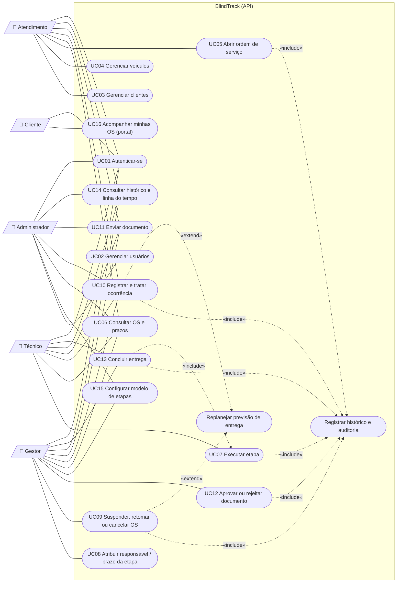

# Casos de Uso

Atores e perfis definidos em [01-visao-geral.md](../requisitos/01-visao-geral.md).
Requisitos (RF) e regras (RN) referenciados estão em [`docs/requisitos/`](../requisitos/).

## 1. Diagrama de casos de uso

O Mermaid não tem um diagrama UML de casos de uso nativo. A notação abaixo usa
`flowchart`: atores à esquerda, casos de uso como elipses (`([...])`) dentro da fronteira
do sistema, e linhas tracejadas para `<<include>>` e `<<extend>>`.

**Leitura do diagrama.** ADMIN e GESTOR também podem executar tudo o que ATENDIMENTO
executa (cadastros e abertura de OS); as linhas foram omitidas para não poluir o desenho.
As permissões exatas, testadas automaticamente, estão na matriz do
[arquitetura.md §7](../../arquitetura.md).

## 2. Especificação dos casos de uso principais

### UC01 — Autenticar-se

| Item                | Descrição                                                                                                                                         |
| ------------------- | ------------------------------------------------------------------------------------------------------------------------------------------------- |
| Atores              | Todos                                                                                                                                             |
| Pré-condição        | Usuário cadastrado e ativo                                                                                                                        |
| Fluxo principal     | 1. Informa e-mail e senha. 2. O sistema confere a senha (bcrypt) e emite um JWT válido por 8 h.                                                   |
| Fluxos alternativos | **A1** Credencial inválida, usuário inexistente ou inativo: 401 com a **mesma** mensagem. **A2** Excesso de tentativas falhas pelo mesmo IP: 429. |
| Pós-condição        | `ultimoLoginEm` atualizado. Tokens emitidos antes da última troca de senha são recusados.                                                         |
| Requisitos          | RF01, RF02, RF05, RNF03, RNF05                                                                                                                    |

### UC05 — Abrir ordem de serviço

| Item                | Descrição                                                                                                                                                                                                                                |
| ------------------- | ---------------------------------------------------------------------------------------------------------------------------------------------------------------------------------------------------------------------------------------- |
| Atores              | Atendimento (também Gestor, Admin)                                                                                                                                                                                                       |
| Pré-condição        | Cliente ativo com veículo cadastrado. Modelo de etapas com ENTREGA ativa como última etapa.                                                                                                                                              |
| Fluxo principal     | 1. Informa cliente, veículo, previsão de entrega e observações. 2. O sistema valida os dados e gera o número `OS-AAAA-NNNNNN`. 3. Copia as etapas ativas do modelo. 4. Registra o histórico ("ABERTA") e a auditoria na mesma transação. |
| Fluxos alternativos | **A1** Veículo de outro cliente: 422 (RN01). **A2** Veículo com OS em aberto: 409 (RN03). **A3** Previsão no passado: 422.                                                                                                               |
| Pós-condição        | OS `ABERTA` com etapas `PENDENTE`.                                                                                                                                                                                                       |
| Requisitos          | RF13, RN01–RN04, RN29                                                                                                                                                                                                                    |

### UC07 — Executar etapa

| Item                | Descrição                                                                                                                                                                                                                                                                                                                                                  |
| ------------------- | ---------------------------------------------------------------------------------------------------------------------------------------------------------------------------------------------------------------------------------------------------------------------------------------------------------------------------------------------------------- |
| Atores              | Técnico responsável (também Gestor, Admin)                                                                                                                                                                                                                                                                                                                 |
| Pré-condição        | OS não encerrada nem suspensa. Etapa com responsável.                                                                                                                                                                                                                                                                                                      |
| Fluxo principal     | 1. Inicia a etapa. 2. (Opcional) Pausa com justificativa e retoma. 3. Conclui. 4. A cada ação, o sistema grava histórico e auditoria e recalcula o status da OS (EM_ANDAMENTO, PRONTA_PARA_ENTREGA).                                                                                                                                                       |
| Fluxos alternativos | **A1** Etapa anterior não finalizada: 422 RN09. **A2** Sem responsável: 422 RN10. **A3** Técnico não responsável: 403 RN16. **A4** Ocorrência impeditiva aberta: 422 RN12. **A5** Gestor dispensa etapa não obrigatória (RN13) ou reabre etapa concluída com as posteriores pendentes (RN15). **A6** Outra requisição alterou a etapa ao mesmo tempo: 409. |
| Pós-condição        | Etapa com novo status; `dataInicio` gravada uma única vez; `dataConclusao` gravada ao concluir.                                                                                                                                                                                                                                                            |
| Requisitos          | RF19, RN08–RN18                                                                                                                                                                                                                                                                                                                                            |

### UC10 — Registrar e tratar ocorrência

| Item                | Descrição                                                                                                                                                                                                                               |
| ------------------- | --------------------------------------------------------------------------------------------------------------------------------------------------------------------------------------------------------------------------------------- |
| Atores              | Usuários internos                                                                                                                                                                                                                       |
| Pré-condição        | OS não encerrada (pode estar suspensa)                                                                                                                                                                                                  |
| Fluxo principal     | 1. Registra título, descrição, tipo, prioridade, responsável e, opcionalmente, etapa afetada e se é impeditiva. 2. O responsável coloca em tratamento e depois resolve, informando a solução.                                           |
| Fluxos alternativos | **A1** (extend UC18) Gestor informa nova previsão de entrega: o replanejamento fica registrado com a ocorrência como motivo (RN23). **A2** Visível ao cliente: exige um texto próprio para o cliente. **A3** Cancelamento exige motivo. |
| Pós-condição        | Histórico registra cada transição. A ocorrência impeditiva resolvida libera a etapa.                                                                                                                                                    |
| Requisitos          | RF29–RF33, RN19–RN24                                                                                                                                                                                                                    |

### UC12 — Aprovar ou rejeitar documento

| Item            | Descrição                                                                                                      |
| --------------- | -------------------------------------------------------------------------------------------------------------- |
| Atores          | Gestor, Admin                                                                                                  |
| Pré-condição    | Documento PENDENTE enviado (UC11)                                                                              |
| Fluxo principal | 1. Analisa o documento (fora do sistema). 2. Registra APROVADO, ou REJEITADO com motivo.                       |
| Observação      | **Decisão humana.** O sistema não valida conteúdo técnico nem legal (RN00); só registra quem decidiu e quando. |
| Requisitos      | RF37, RN17                                                                                                     |

### UC13 — Concluir entrega

| Item                | Descrição                                                                                                                                                            |
| ------------------- | -------------------------------------------------------------------------------------------------------------------------------------------------------------------- |
| Atores              | Técnico responsável pela etapa ENTREGA (também Gestor, Admin)                                                                                                        |
| Pré-condição        | OS `PRONTA_PARA_ENTREGA` e etapa ENTREGA em andamento                                                                                                                |
| Fluxo principal     | 1. Conclui a etapa ENTREGA (inclui UC07). 2. O sistema verifica os requisitos da entrega. 3. Encerra a OS como ENTREGUE e grava a `dataEntrega`, na mesma transação. |
| Fluxos alternativos | **A1** Pendências: 422 RN17, com a lista do que falta (etapas não finalizadas, ocorrências abertas, documentos obrigatórios sem aprovação).                          |
| Pós-condição        | OS encerrada: não aceita mais alterações operacionais (RN05).                                                                                                        |
| Requisitos          | RN05, RN06, RN17                                                                                                                                                     |

### UC16 — Acompanhar minhas OS (portal)

| Item                | Descrição                                                                                                                                                                                                                                  |
| ------------------- | ------------------------------------------------------------------------------------------------------------------------------------------------------------------------------------------------------------------------------------------ |
| Ator                | Cliente                                                                                                                                                                                                                                    |
| Pré-condição        | Usuário CLIENTE vinculado a um cliente                                                                                                                                                                                                     |
| Fluxo principal     | 1. Lista as próprias OS com etapa atual e progresso. 2. Abre uma OS: vê etapas, previsão, situação do prazo, ocorrências e documentos marcados como visíveis, e a linha do tempo com mensagens padronizadas. 3. Baixa documentos visíveis. |
| Fluxos alternativos | **A1** OS ou documento de outro cliente: 404, a mesma resposta de "inexistente" (RN30). **A2** Tentativa de alterar qualquer dado: 403 (RN32).                                                                                             |
| Observação          | Observações internas, justificativas, responsáveis e auditoria nunca são expostos (RN31).                                                                                                                                                  |
| Requisitos          | RF38, RF39, RN30–RN32                                                                                                                                                                                                                      |

Os demais casos de uso (UC02–UC04, UC06, UC08, UC09, UC11, UC14, UC15) são operações de
cadastro ou consulta cujas regras estão nos RF correspondentes e no Swagger
(`/api/v1/docs`).
