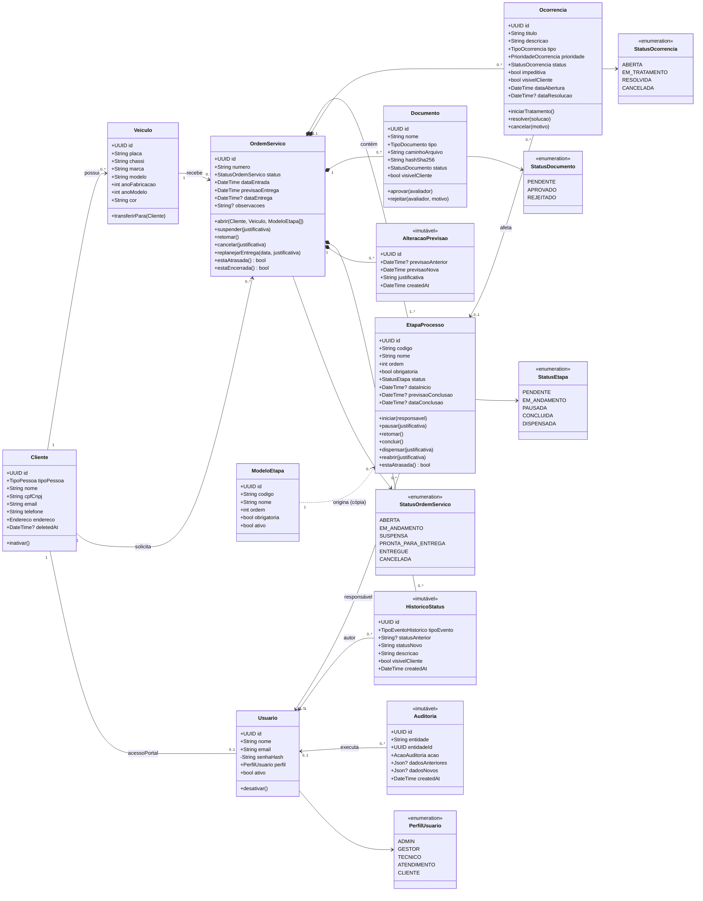

# Diagrama de Classes (domínio)

Visão orientada a objetos das entidades persistidas e dos enums que controlam os estados.
Os métodos indicados são as operações de domínio que os services implementarão na
Fase 4. Não são métodos das entidades do Prisma, que são apenas dados.

**Composição (◆):** etapas, ocorrências, documentos, histórico e replanejamentos não existem
sem a OS. Mesmo assim, nada é excluído em cascata (`onDelete: Restrict`), porque a OS também
nunca é excluída.
