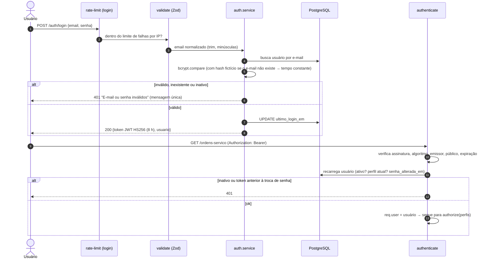
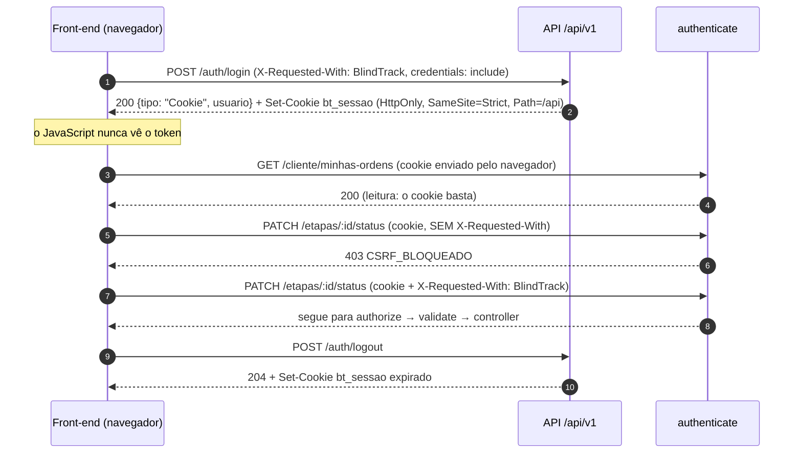
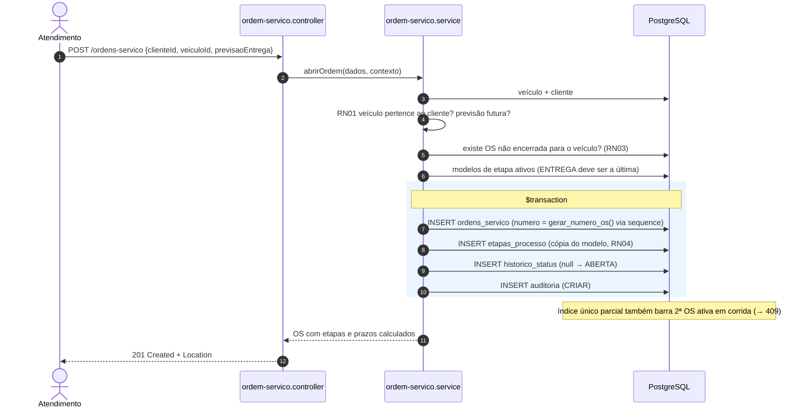
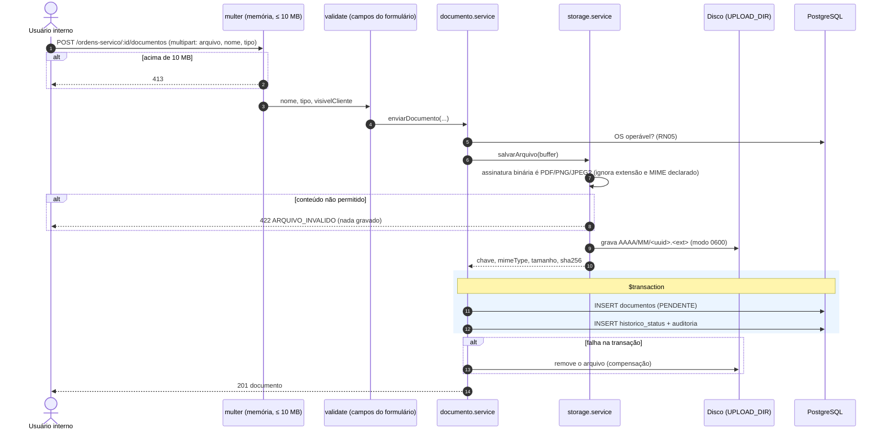
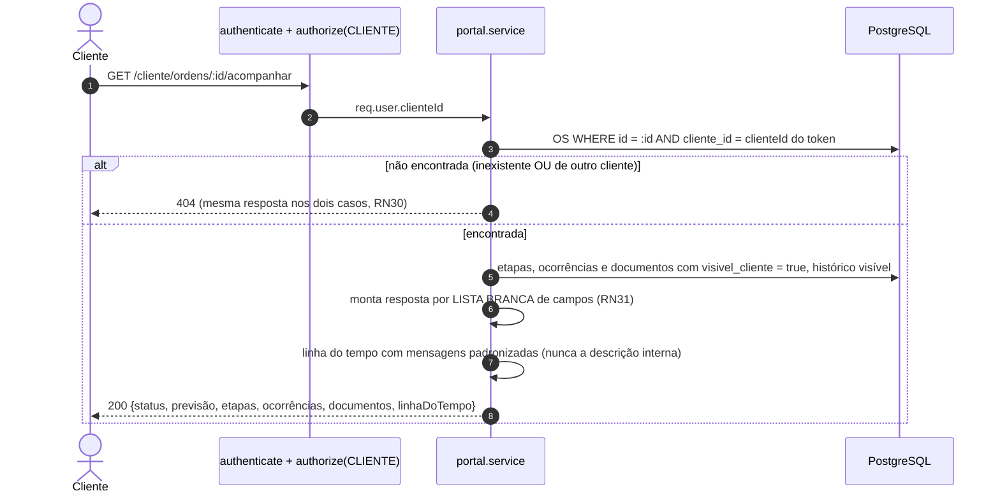

# Diagramas de Sequência

Fluxos principais da API, como estão implementados. O fluxo genérico
"concluir etapa" está no [arquitetura.md §5](../../arquitetura.md).

Convenções: **R** = routes, **MW** = middlewares (`authenticate` → `authorize` →
`validate`), **C** = controller, **S** = service, **D** = domínio puro
(`services/domain`), **DB** = Prisma/PostgreSQL. Toda escrita com mais de uma tabela
acontece numa única `$transaction` (RN29).

## 1. Login e requisição autenticada



### 1.1 Variante do front-end: sessão por cookie HttpOnly (ADR-26)



## 2. Abrir ordem de serviço (UC05)



## 3. Concluir a entrega (UC13, RN17)

```mermaid
sequenceDiagram
    autonumber
    actor T as Técnico responsável
    participant S as etapa.service
    participant D as etapa.state-machine
    participant O as ordem-servico.service
    participant DB as PostgreSQL

    T->>S: PATCH /etapas/:id/status {acao: CONCLUIR}
    rect rgb(235, 245, 255)
        note over S,DB: $transaction
        S->>DB: etapa + OS (encerrada? suspensa? → 422)
        S->>DB: etapas da OS, ocorrências impeditivas da etapa
        S->>D: validarTransicaoEtapa(CONCLUIR)
        D-->>S: ok (perfil, RN16, status, RN12)
        S->>DB: ocorrências abertas na OS; tipos de documento APROVADOS
        S->>D: pendenciasParaEntrega(...)
        alt há pendências
            D-->>S: ["Documentos obrigatórios sem aprovação: ..."]
            S-->>T: 422 RN17 + lista de pendências (rollback)
        else sem pendências
            S->>DB: UPDATE etapa SET CONCLUIDA, data_conclusao WHERE status = EM_ANDAMENTO
            note over S,DB: 0 linhas afetadas → 409 (alteração concorrente)
            S->>DB: INSERT historico_status + auditoria
            S->>O: sincronizarStatusOrdem()
            O->>DB: UPDATE OS SET ENTREGUE, data_entrega
            O->>DB: INSERT historico_status (→ ENTREGUE)
            S-->>T: 200 {etapa, statusOrdem: ENTREGUE}
        end
    end
```

## 4. Enviar documento (UC11)



## 5. Portal: acompanhar OS (UC16)


