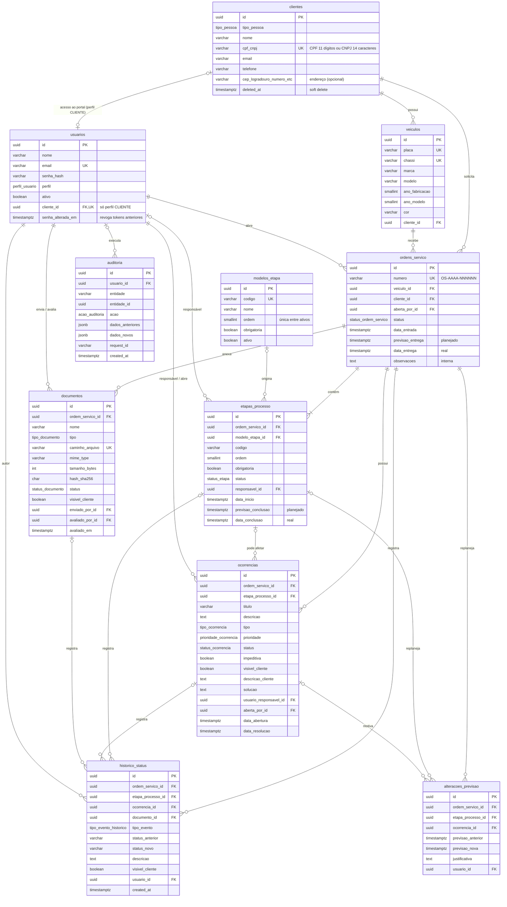

# Modelo de Dados

Fonte da verdade: [`prisma/schema.prisma`](../../prisma/schema.prisma) e as migrations em
[`prisma/migrations/`](../../prisma/migrations/). Este documento explica as escolhas.

## 1. Diagrama entidade-relacionamento

Todas as tabelas com estado mutável têm também `created_at` e `updated_at`. As tabelas
_append-only_ (`historico_status`, `alteracoes_previsao`, `auditoria`) têm só `created_at`.

## 2. Relacionamentos e cardinalidades

| Relação                          | Cardinalidade    | Explicação                                                                                                                                       |
| -------------------------------- | ---------------- | ------------------------------------------------------------------------------------------------------------------------------------------------ |
| Cliente → Veículo                | 1 : N            | Um cliente pode ter vários veículos, e todo veículo tem um dono atual.                                                                           |
| Cliente → OrdemServico           | 1 : N            | Um cliente acumula várias OS ao longo do tempo.                                                                                                  |
| Veículo → OrdemServico           | 1 : N            | Um veículo pode voltar para nova blindagem/manutenção, mas só pode ter **uma OS não encerrada** por vez (índice único parcial, RN03).            |
| Cliente ↔ Usuário                | 1 : 0..1         | O acesso ao portal é opcional. `usuarios.cliente_id` é `UNIQUE` e um CHECK amarra `perfil = CLIENTE ⇔ cliente_id preenchido`.                    |
| OrdemServico → EtapaProcesso     | 1 : 1..N         | Cada OS recebe uma cópia das etapas ativas na abertura. `(ordem_servico_id, ordem)` e `(ordem_servico_id, codigo)` são únicos.                   |
| ModeloEtapa → EtapaProcesso      | 1 : N (opcional) | Rastreia de qual modelo a etapa veio. A etapa guarda cópia de nome, ordem e obrigatoriedade, então mudar o modelo não altera o passado (ADR-01). |
| Usuário → EtapaProcesso          | 1 : N (opcional) | Responsável técnico. É obrigatório quando a etapa está `EM_ANDAMENTO` (CHECK).                                                                   |
| OrdemServico → Ocorrência        | 1 : N            | Toda ocorrência pertence a uma OS e pode, opcionalmente, apontar a etapa afetada.                                                                |
| OrdemServico → Documento         | 1 : N            | Os arquivos ficam no storage. O banco guarda metadados, hash e a avaliação humana.                                                               |
| OrdemServico → HistoricoStatus   | 1 : N            | Linha do tempo imutável. Pode referenciar a etapa, ocorrência ou documento que originou o evento.                                                |
| OrdemServico → AlteracaoPrevisao | 1 : N            | Cada replanejamento (da OS ou de uma etapa) com valor anterior, novo valor e justificativa.                                                      |
| Usuário → Auditoria              | 1 : N (opcional) | `usuario_id` nulo indica ação do sistema.                                                                                                        |

### Por que `ordens_servico.cliente_id` se o veículo já tem cliente?

Não é redundância acidental. É um **registro histórico**: se o veículo for vendido e
transferido para outro cliente, as OS antigas continuam pertencendo a quem as contratou,
e o portal do cliente continua correto. Na abertura, o service valida que o veículo
pertence ao cliente (RN01).

## 3. Decisões de modelagem

| Decisão                                  | Justificativa                                                                                                                                                          |
| ---------------------------------------- | ---------------------------------------------------------------------------------------------------------------------------------------------------------------------- |
| UUID v7 como PK                          | Não expõe volume nem sequência dos registros (diferente de inteiros). Como é ordenado no tempo, mantém os índices B-tree compactos, ao contrário do UUID v4 aleatório. |
| `timestamptz(3)`                         | Grava em UTC com milissegundos, sem ambiguidade de fuso ou horário de verão.                                                                                           |
| snake_case no banco (`@map`)             | Convenção do PostgreSQL. O SQL manual dispensa aspas em excesso, e o código TypeScript continua em camelCase.                                                          |
| Enums nativos do PostgreSQL              | O banco rejeita status inválidos, e o Prisma gera os tipos TypeScript correspondentes.                                                                                 |
| `onDelete: Restrict` em todas as FKs     | Nada é apagado em cascata. Excluir um cliente com veículos ou uma OS com histórico falha no banco.                                                                     |
| Soft delete só em `clientes`             | É a única entidade com uma operação de "exclusão" de negócio (`DELETE /clientes/:id`). Usuários são desativados (`ativo`), e o restante nunca é excluído (ADR-08).     |
| E-mail de cliente não único              | Um mesmo contato pode responder por um CPF e um CNPJ. A unicidade de e-mail vale para `usuarios`, porque é o login.                                                    |
| `status_anterior`/`status_novo` em texto | Uma única tabela de histórico atende OS, etapa, ocorrência e documento. Os valores sempre vêm dos enums, escritos pelos services (ADR-03).                             |
| Atraso não armazenado                    | É calculado na consulta a partir de previsão × data real × agora (RN27c / ADR-05). Os índices `(status, previsao_conclusao)` e `previsao_entrega` atendem o filtro.    |
| `ordem` com intervalos de 10             | O seed usa 10, 20, … 80, o que permite inserir uma etapa nova entre duas existentes sem renumerar.                                                                     |

## 4. Regras garantidas pelo banco (SQL manual nas migrations)

O Prisma não expressa estas regras no schema. Elas estão em SQL na migration
`20261123045844_init` e são ignoradas pelo diff do Prisma (verificado: o `migrate diff`
retorna "empty migration"), então futuras migrations não as removem.

| Regra                                                                                 | Objeto no banco                                                                                  | Ref.          |
| ------------------------------------------------------------------------------------- | ------------------------------------------------------------------------------------------------ | ------------- |
| Número da OS atômico `OS-AAAA-NNNNNN`                                                 | `SEQUENCE os_numero_seq` + `FUNCTION gerar_numero_os()` usada como DEFAULT                       | RN02          |
| Uma OS não encerrada por veículo                                                      | `UNIQUE INDEX ordens_servico_veiculo_ativa_key ... WHERE status NOT IN ('ENTREGUE','CANCELADA')` | RN03          |
| Ordem única entre modelos ativos                                                      | `UNIQUE INDEX modelos_etapa_ordem_ativo_key ... WHERE ativo`                                     | ADR-01        |
| Perfil CLIENTE ⇔ vínculo com cliente                                                  | `CHECK usuarios_cliente_perfil_chk`                                                              | ADR-06        |
| CPF (11 dígitos) / CNPJ (14 caracteres, numérico ou alfanumérico) coerente com o tipo | `CHECK clientes_cpf_cnpj_chk` (ajustado pela migration `cnpj_alfanumerico`)                      | RN33          |
| Placa e chassi normalizados, anos coerentes                                           | `CHECK veiculos_placa_chk`, `veiculos_chassi_chk`, `veiculos_anos_chk`                           | RN34          |
| Etapa em andamento tem responsável                                                    | `CHECK etapas_responsavel_em_andamento_chk`                                                      | RN10          |
| Etapa concluída ⇔ tem data de conclusão                                               | `CHECK etapas_data_conclusao_chk`                                                                | RN11          |
| OS entregue ⇔ tem data de entrega                                                     | `CHECK ordens_servico_data_entrega_chk`                                                          | RN06          |
| Ocorrência resolvida tem data e solução                                               | `CHECK ocorrencias_resolucao_chk`                                                                | RN21          |
| Documento avaliado tem avaliador/data; rejeitado tem motivo                           | `CHECK documentos_avaliacao_chk`                                                                 | RN17          |
| Histórico, replanejamentos e auditoria imutáveis                                      | `TRIGGER ... BEFORE UPDATE OR DELETE` → `impedir_alteracao_registro_imutavel()`                  | RN28 / ADR-04 |

A migration `20261123050519_erro_imutabilidade` ajusta o SQLSTATE do trigger de `23001` para
`P0001`. O código antigo fazia o Prisma relatar o bloqueio como "Foreign key constraint
violated" (P2003), uma mensagem enganosa.

**Defesa em profundidade:** os services (Fase 4) validam todas essas regras antes de gravar
e devolvem mensagens claras (422/409). O banco é a última barreira contra bugs ou acesso
direto.

## 5. Índices

| Tabela                | Índice                                                                                          | Consulta atendida                                                        |
| --------------------- | ----------------------------------------------------------------------------------------------- | ------------------------------------------------------------------------ |
| `clientes`            | `nome`, `email`, `deleted_at`                                                                   | Busca e listagem de clientes ativos                                      |
| `veiculos`            | `cliente_id` (+ únicos `placa`, `chassi`)                                                       | Veículos de um cliente; busca por placa/chassi                           |
| `usuarios`            | `(perfil, ativo)`                                                                               | Lista de técnicos ativos para atribuição                                 |
| `ordens_servico`      | `status`, `cliente_id`, `veiculo_id`, `previsao_entrega`, `data_entrada`                        | Filtros da listagem; portal do cliente; OS atrasadas                     |
| `etapas_processo`     | `(responsavel_id, status)`, `(status, previsao_conclusao)`                                      | "Minhas etapas"; etapas atrasadas                                        |
| `historico_status`    | `(ordem_servico_id, created_at)`, `etapa_processo_id`                                           | Linha do tempo ordenada                                                  |
| `alteracoes_previsao` | `(ordem_servico_id, created_at)`, `etapa_processo_id`                                           | Histórico de replanejamentos                                             |
| `ocorrencias`         | `(ordem_servico_id, status)`, `(etapa_processo_id, status)`, `(usuario_responsavel_id, status)` | Ocorrências abertas por OS/etapa (bloqueios RN12/RN17) e por responsável |
| `documentos`          | `(ordem_servico_id, tipo, status)`                                                              | Verificação dos documentos obrigatórios aprovados (RN17)                 |
| `auditoria`           | `(entidade, entidade_id, created_at)`, `(usuario_id, created_at)`                               | Trilha por registro e por usuário                                        |

## 6. LGPD no modelo

- **Dados pessoais:** nome, CPF/CNPJ, e-mail, telefone e endereço ficam só em `clientes` e `usuarios`.
- **Endereço:** é opcional (minimização).
- **Auditoria:** nunca grava `senha_hash` (responsabilidade do `auditoria.service`, Fase 4).
- **Portal do cliente:** campos visíveis ao cliente são escolhidos explicitamente (`visivel_cliente`, `descricao_cliente`), e as observações internas nunca saem da API interna.
- **Inativação:** um cliente inativado (`deleted_at`) mantém o histórico das OS, que tem obrigação de guarda. A anonimização a pedido do titular está prevista como evolução.

## 7. Seed

`npm run db:seed` é idempotente e cria:

- os 8 modelos de etapa (só `TROCA_VIDROS` é dispensável);
- 5 usuários internos: `admin`, `gestor`, `tecnico1`, `tecnico2` e `atendimento`, todos `@blindtrack.example`, com a senha de `SEED_SENHA_INICIAL`;
- com `SEED_DADOS_EXEMPLO=true` (fora de produção): 2 clientes fictícios, 2 veículos, o usuário de portal `cliente@blindtrack.example` e 2 OS. A `OS-…-000001` está em andamento, com uma etapa atrasada, uma ocorrência impeditiva e um replanejamento. A `OS-…-000002` está aberta e com a entrega vencida.
