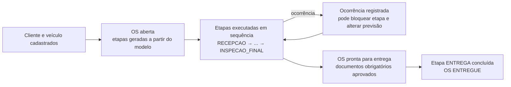

# Visão Geral do Sistema

## 1. Nome provisório

**BlindTrack** — Sistema de Gestão e Rastreabilidade de Blindagem Automotiva.

## 2. Problema

Empresas de blindagem controlam veículos que permanecem semanas na oficina, passando por
várias equipes (desmontagem, manta balística, vidros, remontagem, vistoria). Sem um sistema
central, a informação fica em planilhas, grupos de mensagens e papel. Isso causa:

- perda de rastreabilidade (quem fez o quê, quando);
- atrasos descobertos só na data da entrega;
- ocorrências (falta de peça, retrabalho) sem registro formal;
- documentos obrigatórios esquecidos na entrega;
- clientes ligando para saber do andamento do veículo.

## 3. Objetivo

Oferecer um sistema **administrativo e de rastreabilidade** que registre todo o ciclo de vida
de uma Ordem de Serviço (OS) de blindagem, da recepção do veículo até a entrega, com
histórico imutável, controle de prazos, ocorrências, documentos e um portal de consulta
para o cliente.

## 4. Escopo

### Dentro do escopo

| Área                        | Descrição                                                                                          |
| --------------------------- | -------------------------------------------------------------------------------------------------- |
| Painel administrativo (API) | Cadastro de clientes, veículos, usuários, OS, etapas, ocorrências e documentos                     |
| Rastreabilidade             | Histórico de status e auditoria de alterações, ambos somente de inserção (_append-only_)           |
| Prazos                      | Previsão planejada × data real, detecção de atrasos, justificativa obrigatória para replanejamento |
| Portal do cliente (API)     | Consulta somente leitura das próprias OS, com dados filtrados                                      |
| Segurança                   | JWT, perfis, autorização no backend, LGPD                                                          |

### Fora do escopo (nesta versão)

- Frontend web (o projeto entrega a **API REST**; os dois "ambientes" são separados por rotas e perfis).
- Decisões técnicas de engenharia, certificação balística, inspeção ou conformidade legal.
  O sistema **registra** decisões tomadas por pessoas; ele **não decide**.
- Integração com o Exército (SFPC/SIGMA), Detran ou emissão fiscal.
- Financeiro (orçamentos, pagamentos).
- Notificações por e-mail/WhatsApp (pensado como evolução futura).

## 5. Atores

| Ator                 | Perfil        | Ambiente |
| -------------------- | ------------- | -------- |
| Administrador        | `ADMIN`       | Painel   |
| Gestor de produção   | `GESTOR`      | Painel   |
| Técnico de blindagem | `TECNICO`     | Painel   |
| Atendimento/recepção | `ATENDIMENTO` | Painel   |
| Cliente final        | `CLIENTE`     | Portal   |

## 6. Ciclo de vida resumido

