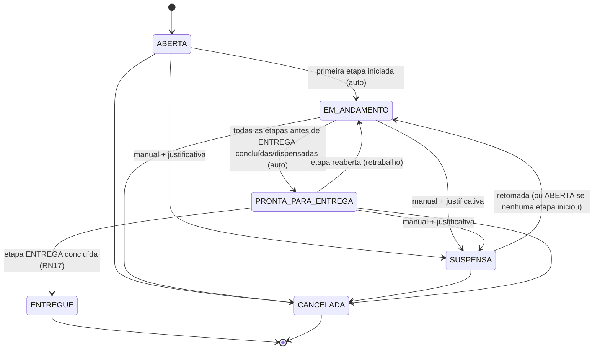
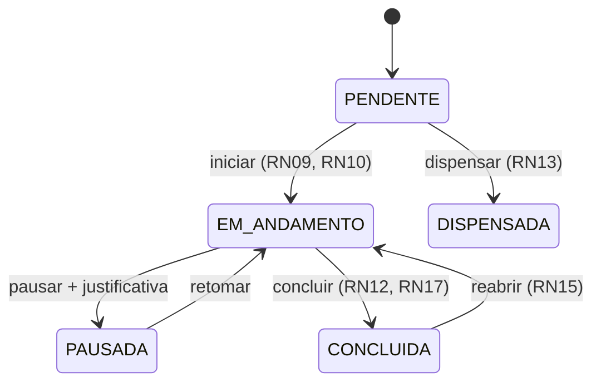

# Regras de Negócio

> Princípio geral (RN00): o sistema é **administrativo e de rastreabilidade**. Vistoria,
> inspeção final, aprovação de documentos e conformidade legal são **decisões humanas**.
> O sistema só registra quem decidiu, quando e o quê. Ele nunca aprova nada automaticamente.

## Ordens de serviço

| ID   | Regra                                                                                                                                                           |
| ---- | --------------------------------------------------------------------------------------------------------------------------------------------------------------- |
| RN01 | Toda OS tem exatamente um cliente e um veículo, e o veículo precisa pertencer ao cliente na abertura.                                                           |
| RN02 | O número da OS é gerado pelo sistema, é único e não muda. Formato: `OS-AAAA-NNNNNN` (sequência do PostgreSQL).                                                  |
| RN03 | Um veículo não pode ter mais de uma OS não encerrada ao mesmo tempo.                                                                                            |
| RN04 | Na abertura, as etapas da OS são copiadas do modelo de etapas ativo. Mudanças posteriores no modelo não afetam OS já abertas.                                   |
| RN05 | OS **encerrada** (`ENTREGUE` ou `CANCELADA`) não aceita alterações operacionais: etapas, ocorrências, documentos e prazos. Só ADMIN pode adicionar observações. |
| RN06 | Uma OS só passa a `ENTREGUE` com a conclusão da etapa `ENTREGA` (RN17). Não existe atalho manual.                                                               |
| RN07 | Cancelar ou suspender uma OS exige justificativa e perfil GESTOR/ADMIN. Uma OS `ENTREGUE` não pode ser cancelada.                                               |
| RN08 | Os status `EM_ANDAMENTO` e `PRONTA_PARA_ENTREGA` são derivados das etapas e aplicados automaticamente pelo service.                                             |

### Máquina de estados da OS

## Etapas

| ID   | Regra                                                                                                                                                                                                                                                                                                            |
| ---- | ---------------------------------------------------------------------------------------------------------------------------------------------------------------------------------------------------------------------------------------------------------------------------------------------------------------- |
| RN09 | As etapas têm um campo `ordem` único dentro da OS. Uma etapa só pode ser **iniciada** quando todas as de ordem menor estão `CONCLUIDA` ou `DISPENSADA`.                                                                                                                                                          |
| RN10 | Uma etapa só pode estar `EM_ANDAMENTO` se tiver responsável (usuário ativo com perfil TECNICO ou GESTOR).                                                                                                                                                                                                        |
| RN11 | Ao concluir, o sistema grava `dataConclusao`. Ao iniciar pela primeira vez, grava `dataInicio`, que não é sobrescrita ao retomar.                                                                                                                                                                                |
| RN12 | Uma etapa não pode ser concluída se houver ocorrência **impeditiva** não resolvida vinculada a ela.                                                                                                                                                                                                              |
| RN13 | Só etapas marcadas no modelo como **dispensáveis** podem ser `DISPENSADA`, e só por GESTOR/ADMIN com justificativa. `VISTORIA`, `INSPECAO_FINAL` e `ENTREGA` são obrigatórias.                                                                                                                                   |
| RN14 | Pausar uma etapa exige justificativa.                                                                                                                                                                                                                                                                            |
| RN15 | Reabrir uma etapa concluída (retrabalho) exige GESTOR/ADMIN, justificativa e que nenhuma etapa posterior tenha saído de `PENDENTE`. Fora disso, o caminho é registrar uma ocorrência do tipo `RETRABALHO`.                                                                                                       |
| RN16 | TECNICO só muda o status das etapas em que é o responsável.                                                                                                                                                                                                                                                      |
| RN17 | Para concluir a etapa `ENTREGA`, é preciso: (a) todas as demais etapas concluídas ou dispensadas; (b) nenhuma ocorrência aberta na OS; (c) todos os documentos dos tipos obrigatórios para entrega com status `APROVADO`. A conclusão grava `dataEntrega` na OS e a encerra como `ENTREGUE`, na mesma transação. |
| RN18 | Toda mudança de status de etapa gera um registro no histórico (RN27).                                                                                                                                                                                                                                            |

### Máquina de estados da etapa

## Ocorrências

| ID   | Regra                                                                                                                                                                    |
| ---- | ------------------------------------------------------------------------------------------------------------------------------------------------------------------------ |
| RN19 | Toda ocorrência tem título, descrição, tipo, prioridade e responsável (usuário interno ativo).                                                                           |
| RN20 | Tipos: `AGUARDANDO_PECA`, `PENDENCIA_DOCUMENTAL`, `RETRABALHO`, `ATRASO`, `OUTROS`. Prioridades: `BAIXA`, `MEDIA`, `ALTA`, `CRITICA`.                                    |
| RN21 | Status: `ABERTA` → `EM_TRATAMENTO` → `RESOLVIDA`, ou `CANCELADA` a partir de qualquer status não final. Resolver grava `dataResolucao` e exige uma descrição da solução. |
| RN22 | A ocorrência pode ser **impeditiva**. Nesse caso, bloqueia a conclusão da etapa vinculada (RN12). Qualquer ocorrência aberta bloqueia a entrega (RN17).                  |
| RN23 | A ocorrência pode informar uma nova previsão de entrega, aplicada como replanejamento (RN26) com a ocorrência como justificativa.                                        |
| RN24 | Ocorrências nunca apagam nem editam o histórico da etapa. Elas geram registros próprios no histórico.                                                                    |

## Prazos

| ID    | Regra                                                                                                                                                                                                                      |
| ----- | -------------------------------------------------------------------------------------------------------------------------------------------------------------------------------------------------------------------------- |
| RN25  | Prazo **planejado** = `previsaoConclusao` (etapa) / `previsaoEntrega` (OS). Prazo **real** = `dataConclusao` / `dataEntrega`. Os dois são guardados separadamente.                                                         |
| RN26  | Qualquer alteração de previsão depois da criação exige justificativa e gera um registro em `AlteracaoPrevisao` (valor anterior, novo valor, motivo, usuário, data).                                                        |
| RN27a | **Etapa atrasada**: não concluída e `previsaoConclusao < agora`, ou concluída com `dataConclusao > previsaoConclusao`.                                                                                                     |
| RN27b | **OS atrasada**: não encerrada e `previsaoEntrega < agora`, ou entregue com `dataEntrega > previsaoEntrega`.                                                                                                               |
| RN27c | O atraso é **calculado na consulta**, nunca armazenado, para não ficar desatualizado.                                                                                                                                      |
| RN27d | Dias de atraso = **dias completos** decorridos desde a previsão, com **mínimo de 1** quando há atraso (1 hora de atraso conta 1 dia; 2,5 dias contam 2). Etapa dispensada e OS cancelada nunca são consideradas atrasadas. |

## Histórico e auditoria

| ID   | Regra                                                                                                                      |
| ---- | -------------------------------------------------------------------------------------------------------------------------- |
| RN27 | Toda mudança relevante registra usuário, data/hora, situação anterior, nova situação e descrição.                          |
| RN28 | Histórico e auditoria nunca são sobrescritos nem apagados (proteção na aplicação e no banco).                              |
| RN29 | O registro de histórico é gravado na **mesma transação** da alteração que o originou. Se um falhar, os dois são desfeitos. |

## Portal do cliente e privacidade

| ID   | Regra                                                                                                                                                                                                                                                                                        |
| ---- | -------------------------------------------------------------------------------------------------------------------------------------------------------------------------------------------------------------------------------------------------------------------------------------------- |
| RN30 | O usuário CLIENTE fica vinculado a exatamente um `Cliente` e só acessa OS desse cliente. Um acesso a OS de outro cliente retorna **404** (não 403), para não revelar se a OS existe.                                                                                                         |
| RN31 | O cliente vê: número, status, veículo, previsão de entrega, etapas (nome, status, datas), ocorrências com `visivelCliente = true` (só o texto para o cliente) e documentos com `visivelCliente = true`. Nunca vê observações internas, responsáveis, auditoria ou dados de outros titulares. |
| RN32 | O cliente não executa nenhuma operação de escrita sobre OS, etapas, ocorrências ou documentos.                                                                                                                                                                                               |

## Cadastros

| ID   | Regra                                                                                                                                                                                                                                   |
| ---- | --------------------------------------------------------------------------------------------------------------------------------------------------------------------------------------------------------------------------------------- |
| RN33 | CPF/CNPJ é único entre clientes, guardado sem pontuação e validado pelos dígitos verificadores. O CNPJ pode ser numérico ou **alfanumérico** (IN RFB 2.229/2024, emitido desde julho/2026): 12 caracteres `[0-9A-Z]` + 2 DVs numéricos. |
| RN34 | Placa (formatos antigo e Mercosul, normalizada em maiúsculas) e chassi (17 caracteres, sem I/O/Q) são únicos.                                                                                                                           |
| RN35 | O e-mail de usuário é único (sem diferenciar maiúsculas e minúsculas). Usuário inativo não autentica.                                                                                                                                   |
| RN36 | Cliente com OS não encerrada não pode ser inativado. Veículos não são excluídos. Usuários são só desativados.                                                                                                                           |
